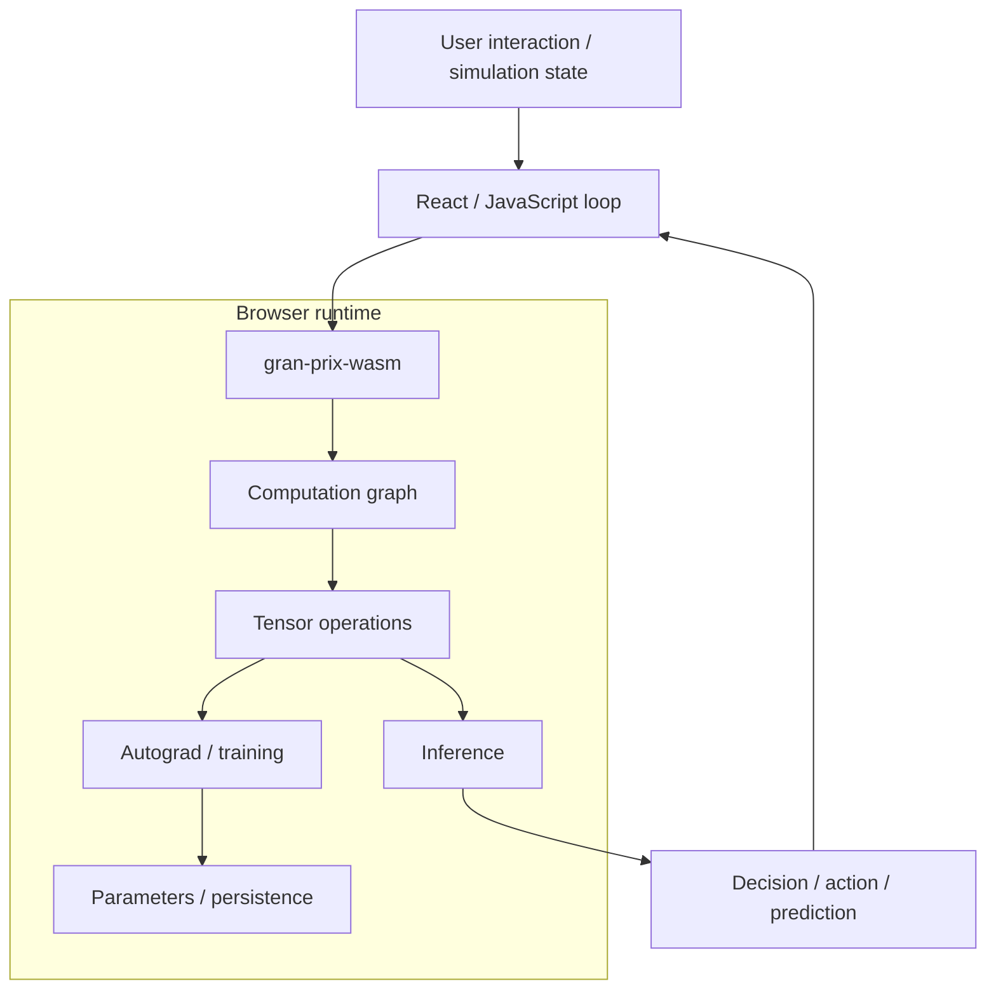

# Gran-Prix: deterministic intelligence in the browser

**Live demo:** [felipe-santos.github.io/gran-prix/](https://felipe-santos.github.io/gran-prix/)

Gran-Prix is a small neural framework for real-time decisions that should not require a cloud LLM call.

It is written in **Rust**, compiled to **WebAssembly**, and designed to run training and inference directly on the user's device. The goal is simple: make operational intelligence cheap, private, low-latency, and inspectable.

Use LLMs for language, reasoning, and open-ended generation. Use Gran-Prix for deterministic micro-decisions: behavioral signals, adaptive UX, local classifiers, control loops, lightweight agents, and interactive learning demos.

---

## Why this exists

Many products now send behavioral problems to language models:

- Will this visitor bounce?
- Is this interaction bot-like?
- Does this user look ready to convert?
- Should this interface adapt now?

Those are not language problems. They are small pattern-recognition and control problems. Sending them to a remote model adds token cost, network latency, infrastructure complexity, and privacy risk.

Gran-Prix is the opposite shape:

- **Local:** runs in the browser through WASM.
- **Deterministic:** no prompt variance, no remote dependency.
- **Private:** raw interaction data can stay on the device.
- **Cheap at scale:** inference has no per-token or per-request vendor cost.
- **Technical:** the neural engine is implemented in Rust, not wrapped around a hosted API.

---

## What it is

Gran-Prix is both:

1. A **Rust neural micro-framework** with tensors, layers, computation graphs, autograd, optimizers, persistence, and backend abstractions.
2. A **visual WASM laboratory** with browser demos that show models learning, evolving, and making decisions in real time.

The project is intentionally positioned between a low-level learning engine and a product-facing proof of concept. It is not trying to compete with PyTorch for research training at cluster scale. It is built for small models that live close to the user.

---

## What it is good for

- **Predictive UX:** detect hesitation, loops, bounce risk, or purchase intent from local interaction signals.
- **Behavioral anti-fraud:** classify cadence, mouse motion, timing, and biomechanical patterns without shipping raw streams to a backend.
- **Local lead scoring:** adapt calls to action or product flows based on a small client-side classifier.
- **Control systems:** train simple agents for drones, ovens, grids, walkers, games, and simulated robots.
- **Education:** show neural networks learning in the browser with visible weights, gradients, rewards, and decision boundaries.
- **Replacing brittle heuristics:** move from piles of frontend `if/else` rules to compact models that can be trained, persisted, and inspected.

---

## Repository map

```text
src/                 Rust core: tensors, graph, layers, loss, optimizers, backends
gran-prix-wasm/      WASM bindings and browser-facing neural agents
packages/wasm/       `@gran-prix/wasm`: the single WASM build (gitignored `dist/web` and `dist/node`)
demo-web/            React + Vite visual laboratory
examples/            Native Rust examples
tests/               Integration, parity, robustness, persistence, and autograd tests
docs/                Theory and project notes
```

Key technical docs:

- [Core map](docs/core-map.md): how the Rust engine is structured and where it is going.
- [WASM contract](docs/wasm-contract.md): how browser code should package architectures, weights, trainers, and agents.
- [Theory notes](docs/theory.md): mathematical foundations for the educational layer.

---

## Core capabilities

- Tensor abstraction with CPU storage and backend-facing design.
- Graph-based execution model with lazy evaluation.
- Reverse-mode autograd for training.
- Layers including linear, activation, batch norm, dropout, RNN, and GRU.
- Losses, optimizers, schedulers, and parameter stores.
- Declarative `NetworkDef` architecture format for validation, compilation, JSON persistence, and WASM interop.
- Model persistence through the canonical `NetworkDef JSON + flat weights` package.
- Full graph and parameter persistence through `serde` where tighter Rust-level coupling is useful.
- WASM bindings for browser inference and evolution.
- Test coverage across math, robustness, recurrence, persistence, CNN paths, and CPU backend behavior. CUDA remains experimental scaffolding.

---

## Architecture



At runtime, the browser sends compact numeric state into WASM. Gran-Prix computes an output locally, and the UI or simulation applies the result immediately. For demos, this can mean a bird jumps, a drone stabilizes, an oven adjusts heat, or a classifier redraws its decision boundary.

---

## Quick start: Rust core

Add the crate locally:

```toml
[dependencies]
gran-prix = { path = "." }
ndarray = "0.15"
```

Build and execute a tiny graph:

```rust
use gran_prix::backend::cpu::CPUBackend;
use gran_prix::graph::{dsl::GraphBuilder, Graph};
use gran_prix::Tensor;
use ndarray::array;

fn main() -> Result<(), Box<dyn std::error::Error>> {
    let backend = Box::new(CPUBackend);
    let mut graph = Graph::new(backend);
    let mut gb = GraphBuilder::new(&mut graph);

    let x = gb.val(array![[1.0, 2.0]].into_dyn().into());
    let w = gb.param(Tensor::new_random(&[2, 2]));
    let b = gb.param(Tensor::new_zeros(&[2]));

    let dense = gb.matmul(x, w);
    let output = gb.add(dense, b);

    let result = graph.execute(output)?;
    println!("Result: {:?}", result);

    Ok(())
}
```

Run examples:

```bash
cargo run --example game_ai
cargo run --example mnist_tiny
cargo run --example braille
cargo run --example memory_demo
```

Run tests:

```bash
cargo test
```

---

## Quick start: WASM laboratory

Build the WASM package (requires `wasm-pack` and the `wasm32-unknown-unknown` Rust target):

```bash
node scripts/build-wasm.mjs --target both \
  --web-out packages/wasm/dist/web --node-out packages/wasm/dist/node
```

Run the visual demo app:

```bash
cd demo-web
npm install
npm run dev
```

Then open the local Vite URL, usually `http://localhost:5173`.

The demo app includes simulations such as:

- Mouse behavior hero demo
- Smart Oven IoT
- Smart Vacuum
- AI Trader
- Smart Grid
- Drone Stabilizer
- Predator vs Prey
- Bipedal Walker
- Flappy Bird RL
- Neural Playground
- Network Builder
- Backprop Classifier

---

## The thesis

| Dimension | Cloud LLM | Gran-Prix |
| :--- | :--- | :--- |
| Primary domain | Language and general reasoning | Behavior, patterns, control, local decisions |
| Runtime | Remote API / cloud GPU | Browser / WASM / local CPU |
| Cost model | Variable token or request cost | No marginal inference vendor cost |
| Latency | Network dependent | Local, usually millisecond-scale |
| Privacy | Raw signals may leave device | Raw signals can remain client-side |
| Output style | Probabilistic text or tool output | Numeric decisions, actions, predictions |

Gran-Prix is not an LLM wrapper, chatbot framework, NLP library, or image generator. It is a focused engine for small neural systems that need to run near the user.

---

## Current direction

The project is moving toward three connected goals:

1. **A reliable Rust core**  
   Keep the math, graph execution, autograd, recurrence, persistence, and backend behavior tested and deterministic.

2. **A credible browser runtime**  
   Make WASM inference and training easy to build, load, inspect, and ship.

3. **A memorable visual proof**  
   Turn the demo web app into a strong public showcase: users should immediately understand that a real neural model is running locally, learning continuously, and making decisions without a server.

The technical spine for that direction is `NetworkDef`: the visual builder, WASM trainer, examples, model persistence, and future demos should all converge on the same architecture contract.

The best first product-facing demo is the behavioral/intention layer: a page that reacts to local mouse and timing signals, shows the model's confidence, and proves the privacy/latency story in one screen.

---

## Development notes

Build the Rust core:

```bash
cargo build
```

Run the web build:

```bash
cd demo-web
npm run build
```

No generated WASM is committed. `demo-web` imports `@gran-prix/wasm`, which resolves to `packages/wasm/dist/web`, so build the WASM (see below) before `npm run dev` or `npm run build`, and again whenever the Rust/WASM API changes. CI and the GitHub Pages deploy build it the same way.

### Building WASM

Requires [`wasm-pack`](https://rustwasm.github.io/wasm-pack/) and the `wasm32-unknown-unknown` Rust target.

```bash
node scripts/build-wasm.mjs --target both \
  --web-out packages/wasm/dist/web --node-out packages/wasm/dist/node   # same as `npm run build` in packages/wasm
node scripts/check-wasm-size.mjs packages/wasm/dist/web/gran_prix_wasm_bg.wasm   # fails if raw > 480,000 B or gzip > 200,000 B
node demo-web/scripts/smoke-test.mjs          # runs the bridge from Node (reads packages/wasm/dist/node)
node demo-web/scripts/seeded-init-check.mjs   # seeded initialization is reproducible
```

The Node scripts read `packages/wasm/dist/node` by default; set `GRAN_PRIX_WASM_NODE` to use another directory. Without options, `scripts/build-wasm.mjs` still writes to `gran-prix-wasm/pkg` (web) and `gran-prix-wasm/pkg-node` (Node).

The build script applies the size profile (`opt-level=z`, LTO, `codegen-units=1`, `panic=abort`, `wasm-opt -Oz`) through `CARGO_PROFILE_RELEASE_*` environment variables, so it keeps working if the crates move into a Cargo workspace. `scripts/check-wasm-parity.mjs <node-package-A> <node-package-B>` checks that two builds produce bit-identical outputs. The CI workflow (`.github/workflows/ci.yml`) runs the Rust tests, this build with the size check, the Node smoke tests and the demo-web build (which consumes the WASM built by the `wasm` job) on pull requests and on pushes to branches other than `main`.

---

## License

See [LICENSE](LICENSE).
